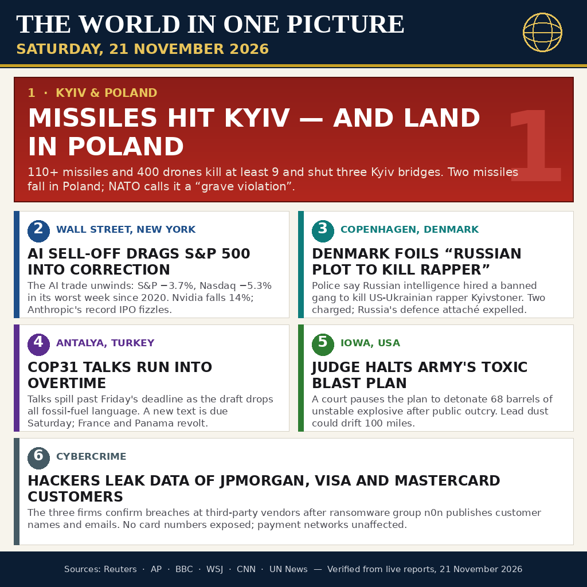

# The World in One Picture — 21 November 2026

[](https://make.fun/bounty/news-image-20261121)
[](https://make.fun/bounty/news-image-20261121)
[](https://make.fun/bounty/news-image-20261121)

One image summing up the world news of **Saturday, 21 November 2026** — the
day's six most consequential stories, from Kyiv to Wall Street, in a single
1024×1024 picture.



## The six stories

1. **Missiles hit Kyiv — and land in Poland (Kyiv & Poland).** Russia launches
   its biggest strike yet: 110+ missiles and 400 drones kill at least 9 people
   and shut three Kyiv bridges. Two missiles fall in Poland; Prime Minister
   Tusk calls it an "intentional provocation" and NATO chief Rutte a "grave
   violation". *Sources: BBC, Reuters, CNN.*
2. **AI sell-off drags S&P 500 into correction (Wall Street, New York).** The
   AI trade unwinds: the S&P 500 falls 3.7% and the Nasdaq 5.3% in its worst
   week since 2020. Nvidia drops 14%; Anthropic's record IPO fizzles.
   *Sources: The Wall Street Journal, Investopedia.*
3. **Denmark foils "Russian plot to kill rapper" (Copenhagen, Denmark).**
   Police say Russian intelligence hired a banned gang to kill US-Ukrainian
   rapper Kyivstoner. Two men are charged; Russia's defence attaché is
   expelled. *Sources: Reuters.*
4. **COP31 talks run into overtime (Antalya, Turkey).** Climate talks spill
   past Friday's deadline as the draft deal drops all fossil-fuel language.
   A new text is due Saturday; France and Panama lead the revolt.
   *Sources: Reuters, UN News, AP.*
5. **Judge halts Army's toxic blast plan (Iowa, USA).** A court pauses the
   plan to detonate 68 barrels of unstable explosive after public outcry.
   Lead dust could drift 100 miles. *Sources: CNN, USA Today.*
6. **Hackers leak data of JPMorgan, Visa and Mastercard customers
   (Cybercrime).** The three firms confirm breaches at third-party vendors
   after ransomware group n0n publishes customer names and emails. No card
   numbers were exposed; payment networks are unaffected.
   *Sources: Reuters, Malwarebytes.*

Every fact above was verified against live reporting published on
21 November 2026. No story is invented.

## How it works

`main.ts` (Node 22, standard library only) copies the entry image to the
output directory. It is fully deterministic — two runs produce
byte-identical output — and makes no network requests.

```sh
mkdir -p out && MAKEFUN_OUTPUT_DIR=out node main.ts
# out/entry.png — 1024×1024 PNG, under 1 MiB
```

## Entry

- Competition: [news-image-20261121](https://make.fun/bounty/news-image-20261121)
- Image: `entry.png` (1024×1024 PNG)
- Program: `main.ts` (Node 22, stdlib only)

---

Built for the [make.fun](https://make.fun/r/515temp1) bounty
`news-image-20261121`. Try make.fun with my referral link:
https://make.fun/r/515temp1
